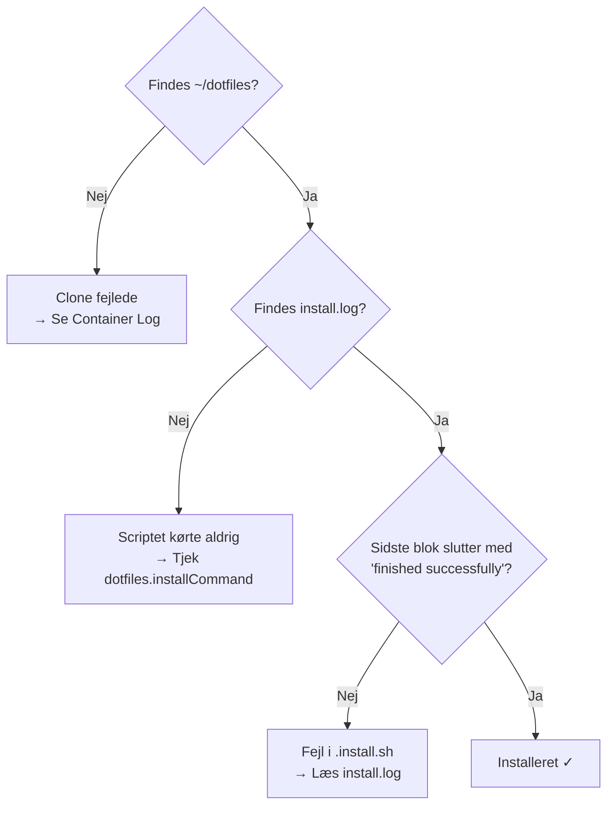

<!-- markdownlint-configure-file { "MD024": { "siblings_only": true } } -->

# Guide: fejlsøg installationen af dotfiles

Denne guide viser, hvordan du tjekker, om dine dotfiles blev installeret i
devcontaineren, og hvordan du finder ud af, hvor det gik galt, hvis de ikke blev.

Først gennemgår vi et forløb, hvor alt **går godt**, så du ved, hvordan det
skal se ud. Bagefter kigger vi på de typiske fejl.

Krav og indstillinger er beskrevet i [devcontainer-dotfiles.md](devcontainer-dotfiles.md).

---

## De tre trin, og hvilke spor de efterlader

Når VS Code bygger containeren, sker installationen af dotfiles i tre trin.
Hvert trin efterlader et spor, du kan tjekke bagefter:

| Trin | Hvad sker der | Spor når det lykkes |
| --- | --- | --- |
| 1. Clone | `git clone <dotfiles.repository> ~/dotfiles` | Mappen `~/dotfiles` findes |
| 2. Install | `cd ~/dotfiles && ./.install.sh` | Filen `~/.devcontainer/logging/install.log` findes |
| 3. Markør | VS Code noterer, at trinnet er kørt | Filen `~/.devcontainer/.dotfilesMarker` findes |

Fejlsøgning handler om at finde **det første spor, der mangler**. Fejlen ligger
i det trin.

> **Vigtigt:** Findes `.dotfilesMarker`, kører VS Code ikke dotfiles-trinnet
> igen, heller ikke hvis det fejlede. Du skal bruge
> **Dev Containers: Rebuild Container** for at prøve forfra.

---

## Eksempel: et vellykket forløb

Følg trinene herunder i en terminal inde i devcontaineren
(**Terminal → New Terminal** i VS Code).

### Trin 1: Blev repoet klonet?

```sh
ls ~/dotfiles
```

Når det er gået godt, ser du repoets pakker:

```text
README.md  bash  claude  nvim  scripts  shell-common  zsh  zsh-config
```

### Trin 2: Kørte install-scriptet?

```sh
cat ~/.devcontainer/logging/install.log
```

Når det er gået godt, ser loggen sådan ud. Hver pakke har et `✓`, og sidste
linje er `Dotfiles installation finished successfully.`:

```text
========================================
dotfiles install started: 2026-11-17T19:19:37+00:00
log: /home/container-user/.devcontainer/logging/install.log
========================================
Running dotfiles install.sh from /home/container-user/dotfiles...
Installing Oh My Zsh...
Cloning into '/home/container-user/.oh-my-zsh'...
Installing Powerlevel10k...
Cloning into '/home/container-user/.oh-my-zsh/custom/themes/powerlevel10k'...
Backing up /home/container-user/.bashrc → /home/container-user/.bashrc_bak_19_19_39
Stowing bash...
  ✓ bash
Stowing claude...
  ✓ claude
Stowing nvim...
  ✓ nvim
Stowing scripts...
  ✓ scripts
Stowing shell-common...
  ✓ shell-common
Stowing zsh-config...
  ✓ zsh-config
Stowing zsh...
  ✓ zsh

Dotfiles installation finished successfully.
```

Linjen `Backing up …` er ikke en fejl. Scriptet flytter de eksisterende
`.bashrc`/`.zshrc` til side, før det erstatter dem med symlinks. I vores image
skriver nvm-installationen en `~/.zshrc`, så du ser typisk også en linje for den.

Har containeren været genopbygget flere gange, indeholder loggen en blok for
hver kørsel. Det er den **sidste** blok, der gælder.

### Trin 3: Peger filerne på dotfiles?

```sh
ls -la ~ | grep -- '->'
```

Når det er gået godt, er shell-filerne symlinks ind i `~/dotfiles`:

```text
lrwxrwxrwx  1 container-user container-user   21 Nov 17 19:19 .bashrc -> dotfiles/bash/.bashrc
lrwxrwxrwx  1 container-user container-user   29 Nov 17 19:19 .p10k.zsh -> dotfiles/zsh-config/.p10k.zsh
lrwxrwxrwx  1 container-user container-user   19 Nov 17 19:19 .zshrc -> dotfiles/zsh/.zshrc
```

### Trin 4: Er markøren sat?

```sh
ls -la ~/.devcontainer
```

Du skal se `.dotfilesMarker` sammen med de andre markører og mappen `logging`:

```text
.dotfilesMarker
.onCreateCommandMarker
.postCreateCommandMarker
.updateContentCommandMarker
logging
```

Ser alle fire trin ud som ovenfor, er dotfiles installeret korrekt. Åbn en ny
terminal, så starter zsh med Powerlevel10k-prompten.

---

## Når noget mangler

Gå trinene igennem i rækkefølge og stop ved det første, der ikke ser ud som i
eksemplet.



### `~/dotfiles` findes ikke: clone fejlede

Clone sker, før dit eget script kører, så fejlen står **ikke** i `install.log`.
Den står i VS Codes container-log:

1. Command Palette (`Ctrl+Shift+P`) → **Dev Containers: Show Container Log**.
2. Søg (`Ctrl+F`) efter `dotfiles`.

Loggen bliver også gemt på hosten. Command Palette → **Developer: Open Logs Folder**,
og find `remoteContainers-*.log` under `exthost*/ms-vscode-remote.remote-containers/`.

Typiske fejlbeskeder:

| Fejlbesked | Årsag | Løsning |
| --- | --- | --- |
| `error: cannot run ssh: No such file or directory` | SSH-URL, men `openssh-client` mangler i imaget | Brug HTTPS-URL eller tilføj `openssh-client` |
| `Problem with the SSL CA cert` | `ca-certificates` mangler i imaget | Tilføj `ca-certificates` |
| `git: not found` | `git` mangler i imaget | Tilføj `git` |

Står der intet om dotfiles i loggen, har VS Code ikke fundet dine indstillinger.
Tjek, at `dotfiles.*` står i dine **user settings** på hosten og ikke kun i en
anden VS Code-profil.

### `install.log` findes ikke: scriptet kørte aldrig

Repoet blev klonet, men scriptet blev ikke startet. Tjek, at
`dotfiles.installCommand` er `.install.sh` (med punktum foran), og at filen
findes:

```sh
ls -la ~/dotfiles/.install.sh
```

### `install.log` slutter ikke med "finished successfully"

Fejlen er i selve installationen. Se efter linjer med `✗` eller `Error`:

```sh
grep -nE '✗|Error|fatal' ~/.devcontainer/logging/install.log
```

| Fejlbesked | Årsag | Løsning |
| --- | --- | --- |
| `Error: Failed to install stow.` | `stow` mangler, og `sudo` uden password er ikke sat op | Tilføj `stow` i Dockerfilen |
| `✗ <pakke> FAILED` | Stow kan ikke lave et symlink, fordi der allerede ligger en almindelig fil | Læs stow-beskeden lige over linjen; flyt eller slet den fil, der står i vejen |

---

## Prøv igen

Når du har rettet årsagen, har du to muligheder.

**Hurtigt, uden at genopbygge:** kør scriptet selv i containeren. Det er sikkert
at køre flere gange; hver kørsel tilføjer en ny blok til `install.log`.

```sh
cd ~/dotfiles && ./.install.sh
```

Mangler `~/dotfiles` helt, så klon først:

```sh
git clone https://github.com/sukkergris/devcontainer-dotfiles.git ~/dotfiles
```

**Rigtigt, som VS Code gør det:** Command Palette → **Dev Containers: Rebuild Container**.
Det er den eneste måde at teste, at hele kæden virker af sig selv næste gang.
Gå bagefter eksemplet ovenfor igennem igen.
